<div align="center">

<picture>
  <source media="(prefers-color-scheme: dark)" srcset="web/static/img/brand/budminder-wordmark-dark.svg">
  
</picture>

**A self-hosted cannabis grow journal.** Daily notes and photos for every plant, live sensors from AC Infinity, Ecowitt or Home Assistant, and your seed vault, all on your own hardware.

[](https://github.com/SirBusta/budminder/releases)
[](https://github.com/SirBusta/budminder/pkgs/container/budminder)
[](LICENSE)

[Install](#install) · [Tour](#tour) · [Releases](https://github.com/SirBusta/budminder/releases)

</div>

<picture>
  <source media="(prefers-color-scheme: dark)" srcset="docs/images/screenshots/plant-dark.webp">
  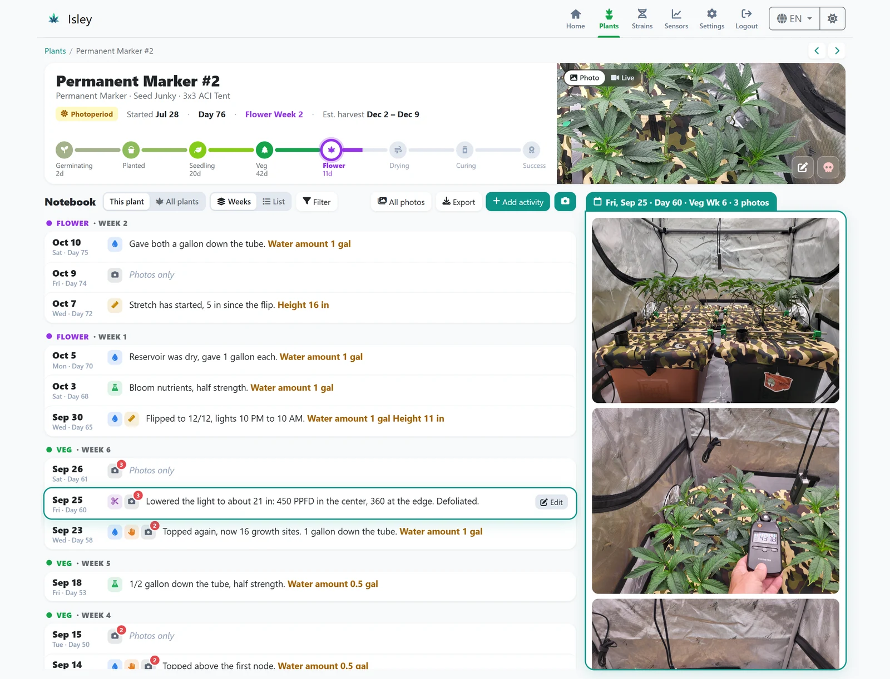
</picture>

<p align="center"><sub>Every plant gets a stage track from seed to harvest and a notebook with one entry per day, shown next to that day's photos.</sub></p>

## Why BudMinder?

**Your grow, on your hardware.** BudMinder runs on your own computer or home server. There's no account to create, no company storing your grow records, and nobody treating you and your data as the product. What you record stays with you.

**Free and open source.** BudMinder is free, with no subscriptions or paid tiers. Its code is public under the MIT license, so anyone can check exactly what it does with your data, suggest improvements, or build on it.

**See what your work does.** Each day's notes, watering and feeding sit right next to that day's photos. Scroll back through a grow and you can see how each change showed up in the plants: when you topped, when you flipped, when the frost came in.

**Don't type in every strain.** Search large public strain databases and add a strain in one click. That brings in its breeder, parents, THC and CBD, effects, terpenes and flowering time. You only fill in what's yours: how many seeds you have and where you keep them.

**Use the sensors you already have.** BudMinder reads AC Infinity controllers and Ecowitt gateways directly, and any sensor Home Assistant knows about: Govee, SwitchBot, Inkbird, Zigbee, ESPHome and more. If Home Assistant can see it, BudMinder can chart it next to your plants.

**Everything in one place.** Sensor readings, a tent camera, your seed stock, harvest weights and every grow you've done, instead of a vendor app, a spreadsheet and a notepad.

**Easy to back up, easy to move.** Make a backup from Settings with one click: your plants, notebook, strains and, if you like, your photos, in a single file you keep. Restore it to bring everything back, or to move BudMinder to a new computer. A backup restores on either kind of database, so you can also switch from SQLite to PostgreSQL later without losing anything. You can also export your journal notes as a CSV or Excel file, with PDF export coming soon.

**Share it if you want to.** Turn on guest view and friends can browse your plants, strains and photos without logging in or being able to change anything. Leave it off and BudMinder stays private behind your login.

BudMinder began as a fork of the excellent [Isley](https://github.com/dwot/isley) by dwot, and builds on it with every page redesigned around a cleaner, more visual layout, plus new features like the daily photo notebook, Home Assistant sensors and strain lookups.

## Tour

### Home Assistant

Already have sensors in Home Assistant? Connect BudMinder once and every sensor Home Assistant knows about (Govee, SwitchBot, Inkbird, Zigbee, ESPHome and more) can be added to a tent, right next to AC Infinity and Ecowitt readings. A scan lists the sensors useful for growing with their live readings; add the ones you want. BudMinder only reads values; it never changes anything in Home Assistant.

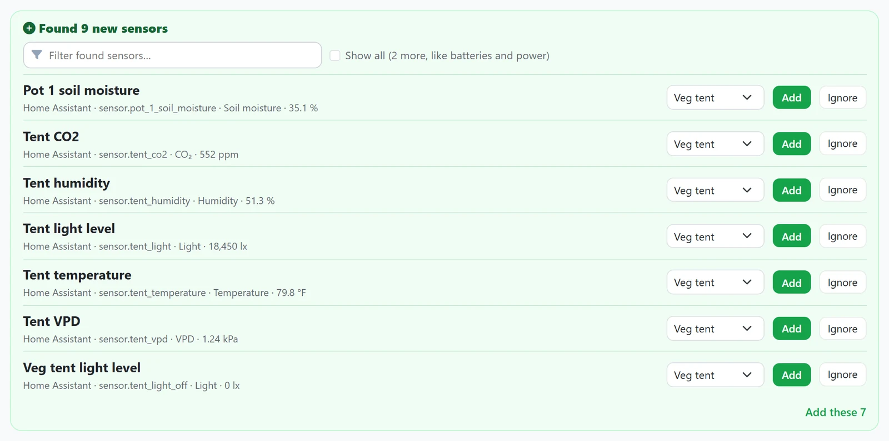

### Today

Open BudMinder and see what needs doing: plants you haven't watered or fed in a while, seeds getting old, and every tent's live temperature, humidity, VPD and CO₂ next to its camera and plants. Log water or feeding right from a plant's card.

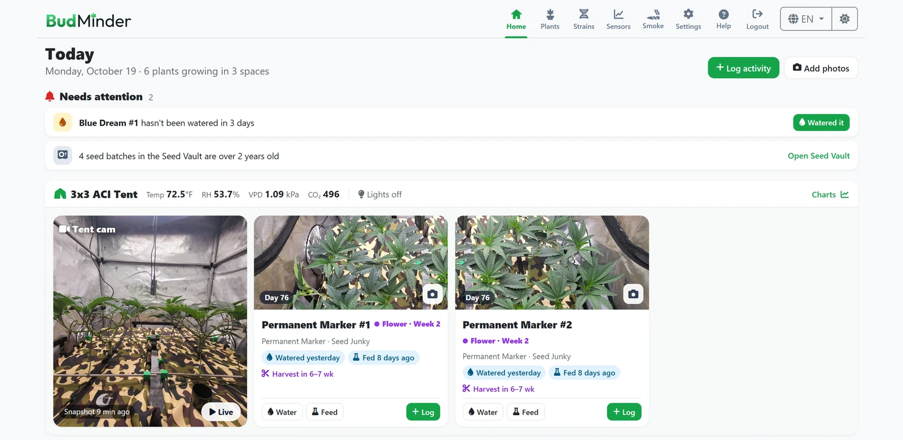

### Environment

Every sensor in a tent on one timeline, from the last hour to the last week or any range you pick. Click anywhere on a chart and a marker line shows what every sensor read at that moment; drag it to scrub through the day. Works with AC Infinity controllers, Ecowitt gateways and any sensor in Home Assistant. If you build your own sensors, a simple API lets you send in their readings.

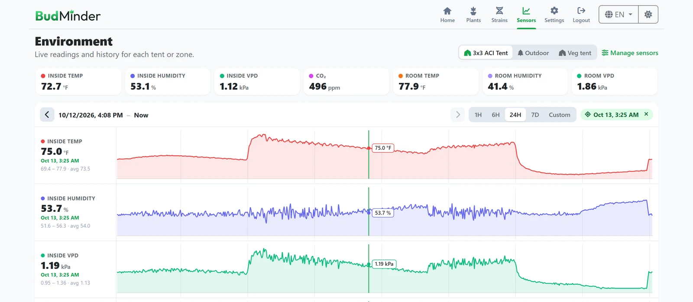

### Seed Vault

The seeds you have on hand, how old they are and where you keep them, with a warning when a batch passes two years. Use one, restock, or start a grow straight from the list, and keep a wish list of strains you want next.

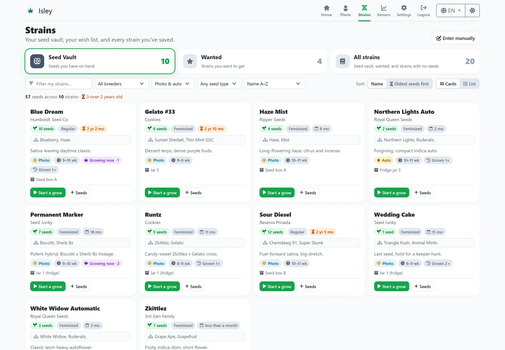

### Strain pages

Everything about a strain in one place: every time you've grown it with yields and flowering times, its family, potency and growing facts, and the photos from your grows. Import a new strain from StrainCompass or CannaDB and most of this fills itself in.

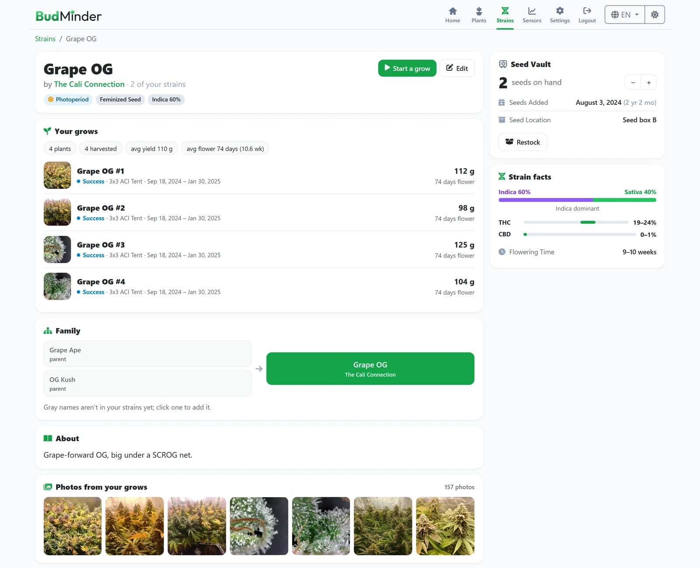

### More

<table>
<tr>
<td width="50%" valign="top"><b>Plants</b><br>Every plant with its stage, progress to harvest, and when it was last watered and fed.<br><br>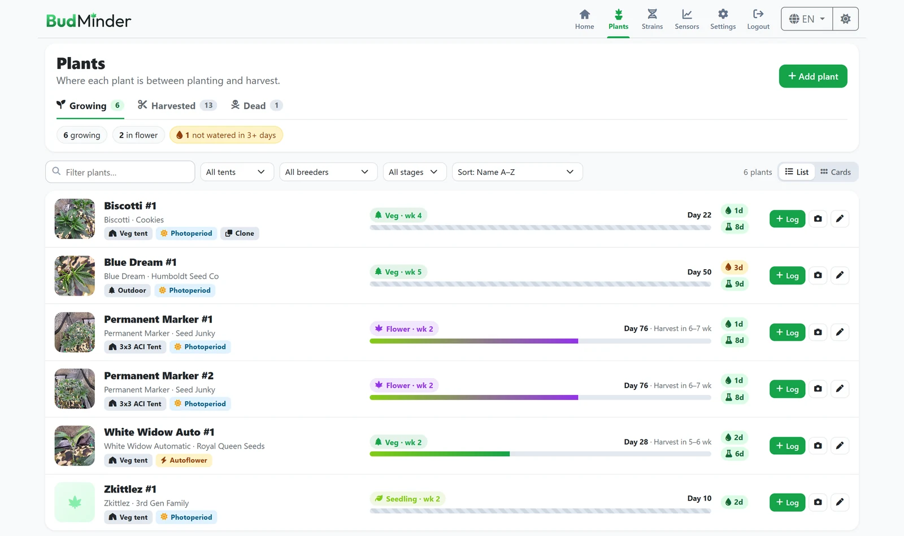</td>
<td width="50%" valign="top"><b>Log activity</b><br>Water, feed, train or add a note for one plant or a whole tent at once, with the amount given.<br><br>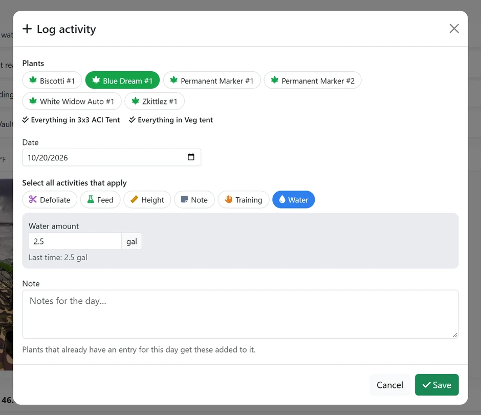</td>
</tr>
<tr>
<td valign="top"><b>Manage sensors</b><br>Scan AC Infinity, Ecowitt and Home Assistant for sensors, name them, put each in a tent and choose where it shows.<br><br>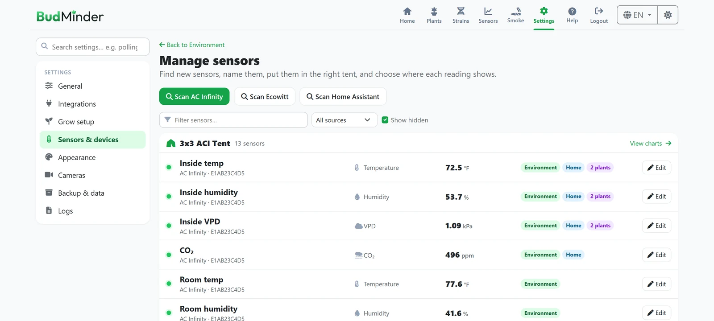</td>
<td valign="top"><b>Settings</b><br>Grouped and searchable, and every change saves as you go.<br><br>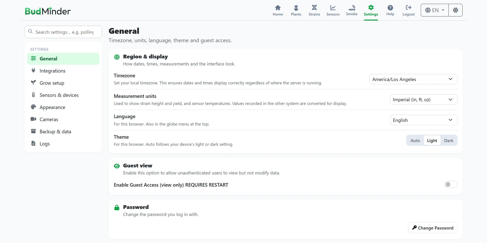</td>
</tr>
</table>

### On your phone

<p align="center">
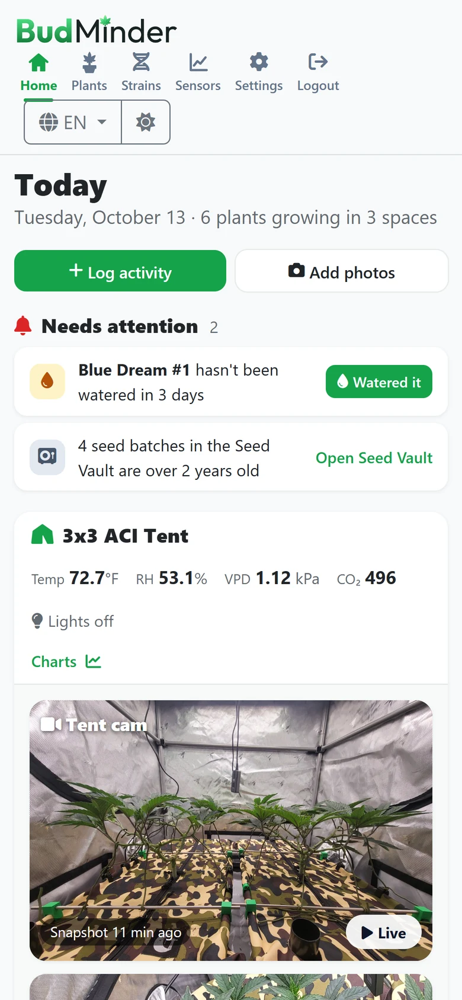&nbsp;&nbsp;&nbsp;
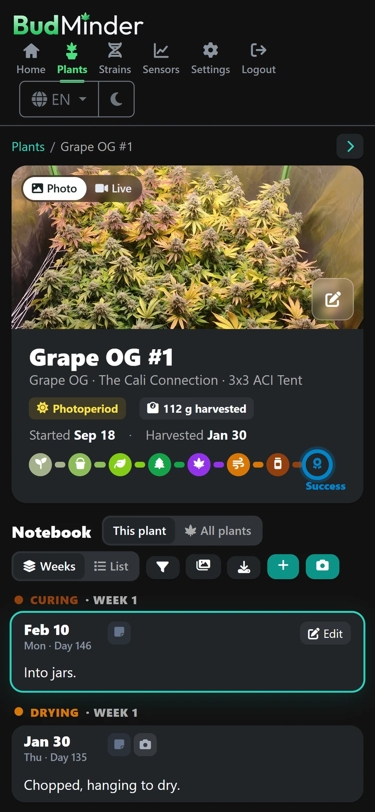
</p>

### And also

- One-click strain import from StrainCompass, with THC and CBD ranges, effects, terpenes and parents
- Imperial or metric units for heights, yields and temperatures
- Everything is served from your own server: no outside fonts, scripts or trackers
- Journal export to CSV or Excel (PDF coming soon)
- Docker images for regular PCs and ARM (Raspberry Pi, newer Macs), plus ready-to-run programs for Windows, macOS and Linux
- Light and dark themes, in English, German, Spanish and French
- A tent camera: live view plus automatic snapshots
- Guest view for sharing, read-only
- SQLite or PostgreSQL, with backups that move between them

<sub>Screenshots use a demo data set. The sensor history is a month of real readings from an AC Infinity controller in a 3x3 tent, and the photos are from real grows.</sub>

## Install

BudMinder runs in Docker. You need [Docker](https://docs.docker.com/get-docker/) with Compose.

**1. Save this as `docker-compose.yml`** (or use [`docker-compose.sqlite.yml`](docker-compose.sqlite.yml) from this repository):

```yaml
services:
  budminder:
    image: ghcr.io/sirbusta/budminder:latest
    ports:
      - "8080:8080"
    environment:
      - BUDMINDER_DB_DRIVER=sqlite
      - BUDMINDER_SESSION_SECRET=replace-with-a-long-random-string-of-32-or-more-characters
    volumes:
      - budminder-data:/app/data
      - budminder-uploads:/app/uploads
    restart: unless-stopped

volumes:
  budminder-data:
  budminder-uploads:
```

**2. Start it:**

```bash
docker compose up -d
```

**3. Open `http://localhost:8080`** (or your server's address).

> [!TIP]
> The first login is **admin** / **budminder**. BudMinder asks you to change the password on first launch.

To update later, run `docker compose pull` and then `docker compose up -d`. Your data stays in the two volumes.

<details>
<summary><b>Unraid</b></summary>

<br>

Add a container (Docker tab, **Add Container**) with:

| Field | Value |
|---|---|
| Repository | `ghcr.io/sirbusta/budminder:latest` |
| Port | Container port `8080` to a host port of your choice |
| Path | Container path `/app/data` to e.g. `/mnt/user/appdata/budminder/data` |
| Path | Container path `/app/uploads` to e.g. `/mnt/user/appdata/budminder/uploads` |
| Variable | `BUDMINDER_SESSION_SECRET` set to a long random string (32+ characters) |

SQLite is used automatically. To use PostgreSQL instead, see the PostgreSQL section below.

</details>

<details>
<summary><b>Without Docker (Windows, macOS, Linux)</b></summary>

<br>

Download the program for your system from the [latest release](https://github.com/SirBusta/budminder/releases/latest) and run it. BudMinder starts on `http://localhost:8080` and keeps its database and photos in `data` and `uploads` folders next to where you run it. Set the same `BUDMINDER_…` settings below as environment variables if you need them.

</details>

<details>
<summary><b>PostgreSQL instead of SQLite</b></summary>

<br>

SQLite is built in and is all most people need. If you'd rather use PostgreSQL, [`docker-compose.postgres.yml`](docker-compose.postgres.yml) starts BudMinder and PostgreSQL together. Put the database password in a `.env` file next to it:

```bash
BUDMINDER_DB_PASSWORD=choose-a-strong-password
BUDMINDER_SESSION_SECRET=replace-with-a-long-random-string-of-32-or-more-characters
```

```bash
docker compose -f docker-compose.postgres.yml up -d
```

To use a PostgreSQL server you already run (on Unraid, another container, or another machine), set `BUDMINDER_DB_DRIVER=postgres` and the `BUDMINDER_DB_HOST`, `BUDMINDER_DB_PORT`, `BUDMINDER_DB_USER`, `BUDMINDER_DB_PASSWORD` and `BUDMINDER_DB_NAME` settings on BudMinder.

**Moving from SQLite to PostgreSQL:** either make a backup in Settings and restore it on the PostgreSQL setup, or use [`docker-compose.migration.yml`](docker-compose.migration.yml). It mounts your SQLite data next to a new, empty PostgreSQL database and copies everything over on first start. Back up first, and switch to `docker-compose.postgres.yml` afterwards.

</details>

## Reference

<details>
<summary><b>Configuration settings</b></summary>

<br>

Most settings live in the app under **Settings**. These few are startup settings, set on the container (or as environment variables) because BudMinder needs them before it starts. The older `ISLEY_…` names (for example `ISLEY_DB_DRIVER`) still work.

| Setting | Default | What it does |
|---|---|---|
| `BUDMINDER_PORT` | `8080` | Port BudMinder listens on |
| `BUDMINDER_SESSION_SECRET` | random | Key that keeps you logged in (32+ characters). Set it, or everyone is logged out each time BudMinder restarts |
| `BUDMINDER_SECURE_COOKIES` | `false` | `true` sends the login cookie over HTTPS only. Turn on behind an HTTPS reverse proxy |
| `BUDMINDER_HSTS_MAX_AGE` | `0` | Above 0, tells browsers to always use HTTPS for this many seconds. Only when BudMinder is reachable over HTTPS alone |
| `BUDMINDER_HSTS_INCLUDE_SUBDOMAINS` | `false` | Adds `includeSubDomains` to the HSTS header |
| `BUDMINDER_HSTS_PRELOAD` | `false` | Adds `preload` to the HSTS header |
| `GIN_MODE` | `release` | `debug` for detailed request logs |
| `BUDMINDER_DB_DRIVER` | `sqlite` | `sqlite` or `postgres` |
| `BUDMINDER_DB_FILE` | `data/isley.db` | Where the SQLite database is kept |
| `BUDMINDER_DB_HOST` | | PostgreSQL server address |
| `BUDMINDER_DB_PORT` | `5432` | PostgreSQL port |
| `BUDMINDER_DB_USER` | | PostgreSQL user |
| `BUDMINDER_DB_PASSWORD` | | PostgreSQL password |
| `BUDMINDER_DB_NAME` | | PostgreSQL database name |
| `BUDMINDER_DB_SSLMODE` | `disable` | `require` or `verify-full` for a PostgreSQL server that uses TLS |

</details>

<details>
<summary><b>Sensors: AC Infinity, Ecowitt, Home Assistant and your own</b></summary>

<br>

**AC Infinity** (UIS controllers). BudMinder reads your controllers through AC Infinity's cloud, so the controller has to be online and on your AC Infinity account.

1. In **Settings → Integrations**, turn on AC Infinity and sign in with your AC Infinity email and password. BudMinder keeps the access token it gets back, not your password.
2. In **Sensors → Manage sensors**, click **Scan AC Infinity** and add the sensors and ports you want.
3. Put each sensor in a tent and choose where it shows.

AC Infinity's sign-in only uses the first 25 characters of a password.

**Ecowitt** gateways (GW1000, GW1100, GW2000 and similar) are read directly on your network, with no cloud account.

1. In **Settings → Integrations**, turn on Ecowitt.
2. In **Sensors → Manage sensors**, click **Scan Ecowitt** and enter the gateway's IP address.
3. Add the sensors you want and put each in a tent. Scan each gateway separately if you have more than one.

**Home Assistant.** Any numeric sensor in Home Assistant can be added: temperature, humidity, CO₂, soil moisture, light, EC and more. BudMinder only reads values; it never changes anything in Home Assistant.

1. In Home Assistant, create a separate user for BudMinder (**Settings → People → Add person**, allow login, *not* an administrator).
2. Log in to Home Assistant as that user, open your profile → **Security** → **Long-lived access tokens**, and create a token. Copy it; Home Assistant shows it only once.
3. In BudMinder, **Settings → Integrations → Home Assistant**: turn it on, enter Home Assistant's address with its port (for example `http://192.168.1.20:8123`), paste the token and click **Test connection**.
4. In **Sensors → Manage sensors**, click **Scan Home Assistant**. Sensors useful for growing are listed first with their current readings; batteries, power and the like appear with **Show all**. Add the ones you want and put each in a tent.

If Home Assistant restarts or is offline for a while, BudMinder logs it and picks the readings back up when it returns.

Readings are collected at the polling interval set in Settings (every 60 seconds by default).

**Your own sensors:** if you build your own (an ESP32 board, for example), you can program it to send readings through the API below.

</details>

<details>
<summary><b>API</b></summary>

<br>

Create an API key in **Settings → Integrations** and send it as an `X-API-KEY` header. The key is shown once; making a new one replaces the old one.

**Send a reading:** `POST /api/sensors/ingest`, one reading per request. A new sensor is created the first time its `source`, `device` and `type` are seen.

```json
{
  "source": "custom",
  "device": "ESP32 tent probe",
  "type": "temperature",
  "value": 25.5,
  "name": "Canopy temp",
  "new_zone": "Tent 1",
  "unit": "°C"
}
```

**Stream overlay:** `GET /api/overlay` returns every growing plant (with its linked sensor readings) and all sensors grouped by source, tent and type. Made for live-stream overlays such as an OBS browser source.

**Sensor history:** `GET /sensorData?sensor=5&minutes=1440` returns readings for one sensor, by `minutes`, or by `start` and `end` dates (`YYYY-MM-DD` or RFC 3339). It needs a login unless guest view is on.

</details>

<details>
<summary><b>Backup and restore</b></summary>

<br>

**From the app:** **Settings → Backup & data**. Choose how much sensor history to include and whether to include photos, then create the backup. It runs in the background and appears in the list to download. Download it to keep it somewhere safe: backups stored only on the same computer are lost if that computer fails. A backup includes your saved connection details, such as the AC Infinity and Home Assistant tokens, so keep backup files private.

**Restoring** replaces everything in the current BudMinder with the backup. Backups are stored as JSON, so a backup made on SQLite restores onto PostgreSQL and the other way around. On SQLite you can also skip sensor history to restore faster, or download and upload the database file itself under **SQLite file transfer**, which is the quickest way to copy a SQLite setup.

Uploads are limited to 5 GB by default; change it in the restore section (minimum 100 MB). Backups are always full backups, and a large backup with photos needs about as much free memory as its size while restoring. For automatic backups, call `POST /settings/backup/create` on a schedule, or back up the Docker volumes.

**From Docker:** everything BudMinder stores is in its two volumes: the database volume (`/app/data`, or PostgreSQL's own volume) and the uploads volume (`/app/uploads`, your photos and camera snapshots). For SQLite, stop the container before copying the database file.

</details>

<details>
<summary><b>Reverse proxy (HTTPS)</b></summary>

<br>

**Nginx**

```nginx
server {
    listen 443 ssl;
    server_name budminder.example.com;

    ssl_certificate     /etc/letsencrypt/live/budminder.example.com/fullchain.pem;
    ssl_certificate_key /etc/letsencrypt/live/budminder.example.com/privkey.pem;

    client_max_body_size 20M;  # photo uploads

    location / {
        proxy_pass http://127.0.0.1:8080;
        proxy_set_header Host $host;
        proxy_set_header X-Real-IP $remote_addr;
        proxy_set_header X-Forwarded-For $proxy_add_x_forwarded_for;
        proxy_set_header X-Forwarded-Proto $scheme;
    }
}
```

**Traefik** (labels on the `budminder` service)

```yaml
labels:
  - "traefik.enable=true"
  - "traefik.http.routers.budminder.rule=Host(`budminder.example.com`)"
  - "traefik.http.routers.budminder.entrypoints=websecure"
  - "traefik.http.routers.budminder.tls.certresolver=letsencrypt"
  - "traefik.http.services.budminder.loadbalancer.server.port=8080"
```

BudMinder trusts `X-Forwarded-For` from private network addresses, so a proxy on your network is handled correctly. Behind HTTPS, also set `BUDMINDER_SECURE_COOKIES=true`.

</details>

## Credits and license

BudMinder is based on [Isley](https://github.com/dwot/isley) by dwot. Strain data comes from [StrainCompass](https://straincompass.com) and [CannaDB](https://cannadb.org). Icons are from [Font Awesome Free](https://fontawesome.com), and the logo is set in [Outfit](https://fonts.google.com/specimen/Outfit).

Found a bug or have an idea? [Open an issue](https://github.com/SirBusta/budminder/issues).

Released under the [MIT license](LICENSE).
